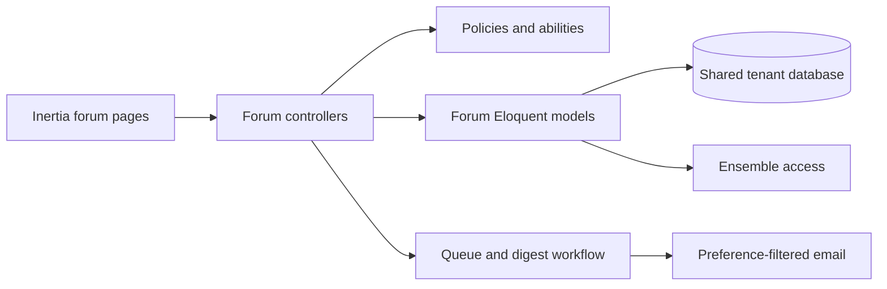

# Requirements

### Overview & Goals
Add a tenant-scoped discussion forum where active choir members can create and participate in organized conversations, while authorized members manage categories and moderation.

### Scope
- Flat categories, each choir-wide or restricted to selected ensembles; topics inherit category visibility.
- Topics and safe Markdown content, replies nested one level, author editing/removal, moderator editing/removal/restoration, and topic lock/pin controls.
- Any-emoji reactions on topics and replies; topic following with a followed-topic view; access-limited `@` member picker.
- One daily tenant-morning digest: new topics go to eligible visible members by default, replies go to topic followers, and mentions go to members who separately opt in. Exclude the author from notifications about their own action.
- Out of scope: attachments, real-time updates, and additional forum capabilities not agreed in the design.

### Acceptance Criteria
- Members cannot see categories, topics, replies, reactions, or mention targets outside their tenant/ensemble access.
- Role abilities govern category management and moderator actions; authors can edit/remove their own content.
- A locked topic rejects new replies; removed content can be restored by authorized moderators.
- Reactions are per member, emoji, and target; following a topic adds it to the member’s followed list and enables reply digest inclusion.
- Forum email preferences and recipient filtering are honored, with digest delivery in the tenant timezone.
- Resolved domain vocabulary is captured in the existing `GLOSSARY.md`; create an ADR only if implementation uncovers a consequential hard-to-reverse decision.

# Technical Design

### Current Implementation
- `app/Models/Poll.php` uses `BelongsToTenant`, `HasEnsembles`, and Eloquent relationships; `app/Models/Traits/HasEnsembles.php` implements ensemble-based visibility querying.
- `app/Http/Controllers/PollController.php`, `app/Models/Policies/PollPolicy.php`, and tenant routes in `routes/tenant.php` demonstrate the controller, authorization, and route conventions. `resources/assets/js/Pages/Polls/` provides the Inertia React page pattern.
- `app/Enums/EmailCategory.php` and `app/Notifications/PollCreated.php` establish email preference, queued notification, and mail-log patterns. `app/Navigation/Navigation.php` defines permission-gated tenant navigation.
- Poll regression tests such as `tests/Feature/PollEnsembleTest.php` provide a reference for feature-level authorization and visibility coverage.

### Key Decisions
- Keep the feature in the established Eloquent/controller/policy/Inertia structure; do not introduce a dedicated service layer.
- Put ensemble restrictions on categories only. Topics and their descendants inherit category access, avoiding conflicting scope rules.
- Store category/topic/reply/reaction/follow/mention relationships relationally. Model one nested reply level explicitly and validate reply parentage/depth.
- Use queued email aggregation into one daily digest, dispatched at the tenant’s morning time using existing tenant-timezone helpers and queue conventions.

### Proposed Changes
Add tenant-scoped forum models and migrations, role abilities and policies, tenant routes/controllers, and Inertia screens. Extend user email-preference handling for forum activity and separately opt-in mention mail. Implement access-filtered mentions, topic following, emoji reactions, moderation state, and a scheduled digest workflow. Add navigation and focused Pest regression tests following existing feature conventions.

### Architecture Diagram

### File Structure
- Add models and policies under `app/Models/` and `app/Models/Policies/`, migrations under `database/migrations/`, plus any forum request validation, notification, and digest job/scheduler pieces under the existing `app/Http/Requests/`, `app/Notifications/`, and `app/Jobs/` / scheduler conventions.
- Add tenant routes in `routes/tenant.php`; update `app/Enums/EmailCategory.php`, email preference UI under `resources/assets/js/Pages/Account/`, and `app/Navigation/Navigation.php`.
- Add forum pages under `resources/assets/js/Pages/Discussions/` and focused feature tests under `tests/Feature/`; update `GLOSSARY.md` with resolved forum terms.

### Risks
- Ensemble access must be enforced consistently in queries, policy checks, member-picker results, digest recipients, and nested reply access—not only in page rendering.
- Safe Markdown requires sanitization before display; mention parsing must resolve only members visible to the current user.
- Daily digest aggregation must avoid duplicates, exclude the actor, and respect tenant timezone and current membership/visibility at delivery time.

# Testing

### Validation Approach
Use focused Pest feature tests modeled on `tests/Feature/PollEnsembleTest.php` and `tests/Feature/PollFilterSortTest.php`, plus tests for forum workflows, policy boundaries, reactions, follows, mentions, and digest recipient construction.

### Key Scenarios
- Verify choir-wide and ensemble-restricted categories are visible only to permitted active members, including through topic/reply routes and mention autocomplete.
- Verify role abilities control category CRUD and moderation; authors may edit/remove their own posts; moderators can lock, pin, remove, and restore content.
- Verify replies cannot exceed one nested level and locked topics reject new replies.
- Verify emoji reactions are unique per member/emoji/target, followers receive reply digest entries, visible members receive new-topic entries, and mention recipients require the separate opt-in.
- Verify daily digest groups eligible events, excludes the actor, respects email preferences, and uses the tenant timezone.

# Delivery Steps

###   Step 1: Build tenant-scoped forum foundations
The forum has persisted categories with safe choir/ensemble visibility and ability-based access control.
- Add tenant-scoped category and topic schema/model foundations, including category-to-ensemble relations consistent with `Poll` and `HasEnsembles` patterns.
- Add category management policy abilities, tenant routes, request validation, and category listing/management Inertia screens.
- Add Pest coverage for tenant boundaries, ensemble visibility, and category authorization.

###   Step 2: Implement topics, nested replies, and moderation
Members can publish and manage discussions with one-level nested replies and authorized moderation.
- Add topic and reply models, migrations, and controller actions; enforce category-inherited visibility and one-level reply parentage.
- Support safe Markdown, author edits/removals, moderator edits/removals/restoration, topic locking, and pinning.
- Add Inertia topic/thread views and feature tests for permissions, locking, nested replies, and restoration.

###   Step 3: Add reactions, following, and member mentions
Members can react to content, follow topics, and safely mention accessible choir members.
- Add reaction and topic-follow persistence and actions, with any-emoji reactions unique per member, emoji, and target.
- Implement the followed-topics view and access-filtered `@` member picker/mention rendering.
- Add separate opt-in mention email preference support and tests for access-safe lookup, follow behavior, reactions, and preference enforcement.

###   Step 4: Deliver forum email digests and integrate navigation
The forum is discoverable in tenant navigation and sends one preference-aware daily digest in the tenant’s morning timezone.
- Extend forum email preference categories/settings, default new-topic email on, keep mention email opt-in, and prepare new-topic/reply/mention digest entries while excluding authors.
- Implement scheduled daily digest aggregation and delivery using existing queue, mail-log, and tenant-timezone conventions; include new topics for visible members and replies for topic followers.
- Add permission-gated navigation and end-to-end feature coverage for digest recipients, duplicate prevention, tenant timezone, and forum visibility.
- Update `GLOSSARY.md` with agreed domain vocabulary; add an ADR only if the implementation reveals a consequential hard-to-reverse trade-off.