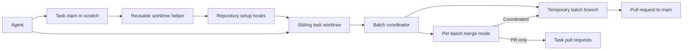

# Requirements

### Goal
Establish a repeatable workflow for agents to work in parallel with low conflict, both across unrelated repositories and on separate tasks within this repository.

### Scope
- Add a reusable Git worktree lifecycle helper and a separate repository-specific setup layer connected through hooks.
- Keep worktrees as sibling folders beside the main checkout; give each claimed task its own branch from a shared agreed base.
- Use `.scratch/<feature>/` issue/task records as the ownership claim and coordination point.
- Define an optional bounded batch coordinator for same-repository parallel work: allocate non-overlapping tasks, track completion, and integrate sibling branches sequentially; it is not a persistent service.
- Use a temporary integration branch per batch. Select coordinated task-branch merges or PR-only task integration per batch; in either mode, promote to `main` only through a pull request.
- Implement the reusable lifecycle helper as a copyable, cross-platform Python CLI; keep repository-specific setup in hooks.
- Adopt pnpm as the only supported JS package manager and actively guard against accidental npm/Yarn installs.
- Use a persistent per-worktree SQLite file for local development and in-memory SQLite for tests; retain MySQL for production and CI, with a documented MySQL option for engine-specific debugging.

### Out of Scope
- A central workspace containing unrelated repository checkouts.
- Nested worktrees, an always-running coordinator, or agents independently integrating concurrent branches.
- Replacing MySQL in production or CI.

### Acceptance Criteria
- An agent can claim a task, create and prepare its sibling worktree, run the repo-specific setup, and safely hand off or remove it using documented steps/helper commands.
- The generic lifecycle is reusable without importing this Laravel project's setup behavior.
- SQLite fresh-database test runs work for supported local/worktree usage; MySQL remains runnable for engine-specific checks and remains the CI/production engine.
- Setup and CI use pnpm consistently, and unsupported npm/Yarn install paths fail with a clear message.

# Technical Design

### Current Implementation
- `AGENTS.md` is the shared project guidance source; `CLAUDE.md` points agents to it. `README.md` documents only a single-checkout setup. `docs/agents/issue-tracker.md` and `docs/agents/triage-labels.md` provide the existing task-claim vocabulary and `.scratch/<feature>/` conventions.
- No worktree lifecycle script or parallel ownership/integration procedure exists. Existing `scripts/` utilities serve visual regression and Font Awesome workflows.
- Current frontend setup is npm-based (`package-lock.json`, plus a stray `yarn.lock`); `README.md` uses Node 20 while `.chipperci.yml` uses Node 22. `.npmrc` contains a configured scoped private registry and an authentication-token value, which should not be copied into reusable helpers or documentation.
- `composer.json` requires PHP `>=8.4`; `README.md` says PHP 8.2, while CI uses 8.4. `config/database.php` defaults to MySQL and already defines SQLite. `phpunit.xml` does not select a DB driver; test setup uses `RefreshDatabase`.
- SQLite fresh migrations encounter MySQL-specific operations, including `ENGINE=InnoDB` in `database/migrations/2023_07_16_011248_create_enrolments_table.php` and `INFORMATION_SCHEMA` access in `database/migrations/2026_03_31_120000_convert_singer_status_to_enum.php`. Application query paths also contain `CONCAT(...)` expressions that require compatibility review.

### Key Decisions
- Provide the generic Git lifecycle as a copyable, cross-platform Python CLI that manages create/list/safe-remove and invokes repository-supplied setup/teardown hooks; keep dependencies, environment, and database setup in the repo-specific layer.
- Keep task worktrees as siblings with branches from one agreed base. A bounded coordinator operates per batch, which uses a temporary integration branch; choose coordinated task-branch merges or PR-only task integration per batch, and always promote the batch branch to `main` through a pull request.
- Use a persistent SQLite file per worktree for local development and in-memory SQLite for tests; retain an explicit MySQL selection path and MySQL-based CI/production.
- Make pnpm the sole supported JS manager, remove competing lockfiles/configuration as appropriate, and enforce the policy rather than relying only on docs.

### Proposed Changes
Create a copyable Python CLI for generic worktree lifecycle operations and a repository-owned setup/teardown hook layer with a documented interface. Explain task claiming, ownership boundaries, base-branch agreement, per-batch integration branch and mode selection, the mandatory PR to `main`, handoff, safe cleanup, and failure recovery in agent-facing guidance. Update top-level guidance to link to the detailed workflow and reconcile runtime/setup instructions. Add an ADR for the consequential mixed-engine database and reusable-helper boundary decisions; update glossary terminology only if the workflow introduces domain terms that belong there.

Implement SQLite compatibility as a deliberate migration/query compatibility effort, not a test-environment toggle alone: address MySQL-only migration operations and relevant query paths while validating MySQL behavior remains intact. Use a persistent SQLite file for per-worktree local development and in-memory SQLite for tests; retain a documented MySQL profile. Convert package metadata, lockfile, scripts, CI, and setup instructions to pnpm, and add a lightweight guard against npm/Yarn installs.

### Architecture Diagram

# Testing

### Validation Approach
- Exercise generic lifecycle operations in a disposable local Git repository: create a sibling worktree/branch from the agreed base, list it, and confirm removal refuses dirty worktrees while permitting clean removal.
- Validate repo-specific setup hooks from a fresh worktree, including independent per-worktree dependencies/environment, persistent local SQLite storage, and in-memory test isolation.
- Run the migration suite and relevant tests against in-memory SQLite; run representative engine-sensitive tests against MySQL and preserve the CI MySQL configuration.
- Verify pnpm clean install/build/test paths and CI commands; confirm npm/Yarn install attempts are rejected without exposing registry credentials.
- Review docs and helper output for alignment with `.scratch` claims, ownership, handoff, integration, and cleanup conventions.

# Delivery Steps

###   Step 1: Define the reusable worktree lifecycle and coordination contract
The repository has a documented, reusable sibling-worktree lifecycle with task ownership and a bounded integration coordinator.
- Add the detailed workflow under `docs/agents/` and link it from `AGENTS.md` and `README.md`.
- Specify generic helper operations, the interface to project-specific setup/teardown hooks, branch/worktree naming, shared-base expectations, and safe refusal of destructive cleanup when changes are uncommitted.
- Document task claims through `.scratch/<feature>/`, disjoint task/file ownership, coordinator responsibilities for a batch, temporary integration branches, per-batch coordinated-versus-PR-only task integration, mandatory PR promotion to `main`, handoff, and recovery without a long-running agent.

###   Step 2: Implement generic lifecycle automation and this repository’s setup hooks
Agents can create, inspect, prepare, and safely remove sibling worktrees through separated generic and repository-specific automation.
- Add a copyable, cross-platform Python CLI that manages Git worktrees and invokes repository-supplied hooks without embedding Laravel-specific assumptions.
- Add this repository’s setup/teardown hook layer for independent per-worktree dependencies, local configuration, persistent SQLite development storage, and test database preparation/cleanup.
- Keep credentials out of helper code and documentation; use existing local secret/configuration mechanisms rather than copying `.npmrc` token material.

###   Step 3: Enable SQLite local and worktree development while retaining MySQL
Fresh SQLite-backed local/worktree test runs succeed while production, CI, and explicit MySQL debugging remain supported.
- Update the MySQL-specific migration operations, beginning with `2023_07_16_011248_create_enrolments_table.php` and `2026_03_31_120000_convert_singer_status_to_enum.php`, so fresh SQLite migrations can run without changing intended MySQL behavior.
- Review and adapt relevant query paths such as the `CONCAT(...)` expressions in custom sorts and search code where SQLite compatibility is required.
- Configure SQLite-default local/worktree execution with persistent per-worktree development files and in-memory tests, plus an explicit MySQL test/debug option; retain MySQL as the production and CI engine.
- Add/update focused tests and validate clean migrations and representative behavior on both engines.

###   Step 4: Migrate frontend setup and CI to enforced pnpm-only usage
Repository setup and CI use pnpm consistently, and accidental npm/Yarn installs are rejected clearly.
- Convert dependency metadata and lockfile from npm/Yarn artifacts to pnpm, including a declared package-manager version and suitable install guard.
- Update `README.md`, agent guidance, and `.chipperci.yml` to use one compatible Node version and pnpm install/build/test commands.
- Remove obsolete manager lockfiles/configuration only after confirming no supported workflow depends on them; do not expose or duplicate private registry credentials.
- Validate a clean pnpm install and the affected build/test commands.

###   Step 5: Record and verify the finalized operating decisions
The durable decisions and workflow are internally consistent and validated against the repository’s current conventions.
- Add a focused ADR for the consequential helper boundary and mixed SQLite/MySQL strategy, and refine glossary terms only where needed for shared vocabulary.
- Reconcile PHP and Node setup guidance across `README.md`, `AGENTS.md`, CI, and the worktree guide.
- Exercise the helper’s safe lifecycle behavior in a disposable Git repository and verify the documented coordinator and handoff flow.